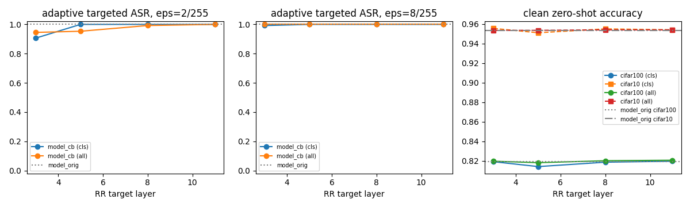

# CLIP + Circuit Breakers

Adapts **representation rerouting**, the training method behind "Improving Alignment and
Robustness with Circuit Breakers" (Zou et al., 2024, [arXiv:2406.04313](https://arxiv.org/abs/2406.04313)),
from language models to the image encoder of CLIP (OpenCLIP ViT-B/32, DataComp weights).

**Question:** can rerouting make CLIP resist targeted adversarial attacks without hurting its
normal (clean) accuracy?

**Short answer:** partly. Applied at an early layer, it blocks attacks that were built against
the original model, with no loss in clean accuracy. But an attacker who attacks the modified
model directly still succeeds almost every time, so it does not give white-box robustness.
Which layer it is applied at matters a lot, and a simple probe predicts which layers work.

## Key terms

- **CLIP zero-shot classification:** CLIP embeds an image and a text prompt per class
  ("a photo of a dog") in the same space; the predicted class is the prompt closest to the image.
  No classifier is trained.
- **Block / layer:** one of the 12 transformer blocks in CLIP's image encoder (numbered 0-11).
  The **representation** at a block is its output, one 768-dim vector per token.
- **CLS token / patch tokens:** the image is cut into 49 patches, each a token, plus one extra
  summary token (CLS). CLIP's final output is read from the CLS token.
- **PGD attack:** projected gradient descent, the standard adversarial attack. It adds a small
  perturbation to the image, at most **eps** per pixel (e.g. 8/255), chosen by gradient steps.
- **Targeted attack:** the attacker picks a wrong class and tries to make CLIP predict it.
- **ASR (attack success rate):** fraction of attacked images classified as the attacker's target.
- **Robust accuracy:** fraction of attacked images still classified correctly.
- **Adaptive attack:** the attack is computed against the defended model itself (white-box).
  This is the real test of a defense.
- **Transfer attack:** images attacked against the original model, then fed to the defended
  model. Weaker than an adaptive attack.
- **Gradient masking:** a defense that only looks robust because it breaks the attacker's
  gradients. Warning sign: transfer attacks succeed more often than adaptive ones.
- **Representation rerouting (RR):** fine-tune the model so that, for "bad" inputs, the
  representation at a chosen layer is pushed away from where the original model puts it, while
  for normal inputs it stays the same. Here "bad" = a successfully attacked image.
- **LoRA:** a cheap fine-tuning method that adds small trainable matrices to a frozen model.
- **Probe AUC:** how well a simple linear classifier can tell clean from attacked
  representations (0.5 = chance, 1.0 = perfect).
- **Target-likeness:** how often an attacked image's representation is closer to the average
  representation of the *target* class than to any other class. High means the attack already
  looks like a real image of the target class at that layer.

## How it works

Two copies of CLIP: the frozen original (`model_orig`) and a copy with LoRA adapters on a few
blocks (`model_cb`). At a chosen block, training minimizes two losses:

- **Rerouting loss** `L_s = ReLU(cos_sim(rep_cb, rep_orig))` on attacked images: push their
  representation away from the original model's (until the cosine similarity is 0 or below).
- **Retain loss** `L_r = ||rep_orig - rep_cb||_2` on clean images: keep their representation unchanged.

Combined as `L = c_s(t) * L_s + c_r(t) * L_r` with the paper's schedule
`c_s(t) = alpha(1 - t/2T)`, `c_r(t) = alpha * t/2T`: rerouting dominates early, retaining late.

The training images are pairs of a clean CIFAR-100 image and its targeted PGD version (8/255),
kept only when CLIP gets the clean image right *and* the attack succeeds.

## Running it

CIFAR-100 is already downloaded in `../../PaperThree/data`, so pass that as `--data-root`.
CIFAR-10 (used as a held-out accuracy check) downloads into `./data`. Use a GPU in a
performance power mode: on the test laptop, "Silent" mode was 3.6x slower.

1. **Probe the layers:**
   ```
   python probe_layer_separability.py --data-root ../../PaperThree/data
   ```
   Writes probe AUC and target-likeness per block to `layer_separability.json` / `.png`.

2. **Train:**
   ```
   python train_rr.py --target-layer 3 --rep-tokens all --ls-warmup-frac 0.2 --lora-b-init-std 1e-2 --data-root ../../PaperThree/data
   ```
   `--rep-tokens all` applies the losses to every token (as the paper does); `cls` uses the CLS
   token only. Saves the LoRA weights and a training log (`*_train_log.json`). If `1-adv_cos`
   in the log never grows, the model didn't learn to reroute; train for more steps.

3. **Evaluate:**
   ```
   python evaluate.py --checkpoint rr_checkpoint.pt --data-root ../../PaperThree/data
   ```
   Reports, for the original and defended model: clean accuracy on CIFAR-100 and CIFAR-10, how
   much clean representations changed, and targeted ASR / robust accuracy / untargeted error at
   eps 1, 2, 4, 8 /255 under the adaptive and transfer attacks, with a gradient-masking check.

4. **Layer sweep** (train + evaluate several layers and token modes; resumable):
   ```
   python run_layer_sweep.py --data-root ../../PaperThree/data --layers 3,5,8,11 --rep-tokens cls,all
   ```
   Uses a smaller budget so all 8 configurations fit in about an hour (200 training steps;
   evaluation on 128 images, 50 PGD steps, eps 2 and 8). Large caches go to the system temp
   folder (`--cache-dir`) to keep them out of the synced project folder; outputs go to `runs/`.

## Results

### Layer probe

415 successful 8/255 attacks on CIFAR-100 training images. Full output: `layer_separability.json`.

| block | 0-6 | 7 | 8 | 9 | 10 | 11 |
|---|---|---|---|---|---|---|
| CLS target-likeness | <1.5% | 3% | 11% | 25% | 60% | **93%** |
| patch-token target-likeness | <13% | 25% | 51% | 63% | 73% | 62% |

- A linear probe separates clean from attacked images at every block (AUC ~1.0), so
  detectability doesn't distinguish layers at this eps.
- Target-likeness does. At block 11, attacked images look like the target class more reliably
  than clean images match their own class (86%). Rerouting there would also push away real images
  of that class, which the retain loss forbids. Through block 6, attacks don't yet look like the
  target, so rerouting them shouldn't conflict with clean images.

### Layer sweep

Original model: clean accuracy 0.819 (CIFAR-100) / 0.954 (CIFAR-10), ASR 1.00. Sweep budget
(128 images), so differences of a few points are within noise.

| block | tokens | learned to reroute? | clean acc change C100 / C10 | transfer ASR eps 2 / 8 | adaptive ASR eps 2 / 8 |
|---|---|---|---|---|---|
| 3 | cls | yes | +0.000 / +0.002 | 0.02 / 0.01 | 0.91 / 0.99 |
| 3 | all | yes | +0.001 / +0.000 | 0.05 / 0.03 | 0.95 / 1.00 |
| 5 | cls | yes | -0.005 / -0.003 | 0.26 / 0.16 | 1.00 / 1.00 |
| 5 | all | yes | -0.001 / +0.000 | 0.03 / 0.02 | 0.95 / 1.00 |
| 8 | cls | yes | -0.000 / +0.001 | 0.94 / 0.88 | 1.00 / 1.00 |
| 8 | all | yes | +0.001 / +0.000 | 0.54 / 0.05 | 0.99 / 1.00 |
| 11 | cls | no | +0.001 / +0.000 | 1.00 / 1.00 | 1.00 / 1.00 |
| 11 | all | no | +0.002 / +0.000 | 1.00 / 1.00 | 1.00 / 1.00 |



### Full evaluation of the two best configurations

`evaluate.py` at its defaults: 256 attacked CIFAR-100 test images, 100 PGD steps, clean accuracy
on the full CIFAR-100 and CIFAR-10 test sets (10,000 images each). Raw output:
`results/full_eval_L3_cls.json`, `results/full_eval_L5_all.json`.

| | original model | block 3, CLS | block 5, all tokens |
|---|---|---|---|
| clean accuracy, CIFAR-100 | 0.805 | 0.804 (-0.001) | 0.806 (+0.000) |
| clean accuracy, CIFAR-10 | 0.953 | 0.953 (+0.000) | 0.952 (-0.000) |

Targeted ASR (lower is better for the defense):

| eps | original model | block 3, CLS: transfer | block 3, CLS: adaptive | block 5, all: transfer | block 5, all: adaptive |
|---|---|---|---|---|---|
| 1/255 | 0.99 | 0.02 | 0.95 | 0.09 | 0.92 |
| 2/255 | 1.00 | 0.02 | 0.93 | 0.02 | 0.99 |
| 4/255 | 1.00 | 0.00 | 0.99 | 0.01 | 1.00 |
| 8/255 | 1.00 | 0.00 | 1.00 | 0.02 | 1.00 |

No gradient masking was flagged at any eps (transfer ASR was always below adaptive ASR). Robust
accuracy stays near 0 everywhere (at most 0.08), because rerouted images are misclassified
rather than corrected (see point 3 below).

### What this means

1. **Early layers work, late layers don't, as the probe predicted.** Blocks 3-5 block the
   original model's attacks on new images (0-2% ASR in the full evaluation, up to 9% at eps 1/255),
   including at eps they never trained on (training used 8/255 only). Block 8 reroutes its training images but mostly not new ones. Block 11 can't learn to
   reroute at all: it can only move clean and attacked representations together, and the retain
   loss undoes that.
2. **No white-box robustness.** An adaptive attack finds a different perturbation that avoids
   the rerouted region and still succeeds almost every time. This matches the original paper's
   remark that robustness for standalone image classifiers "remains an open challenge".
3. **Rerouted images are scrambled, not corrected.** When a transferred attack fails, the image
   is still misclassified (untargeted error ~0.99). That is how circuit breakers are meant to
   work: they break the harmful output rather than restore the right one. So targeted ASR, not
   robust accuracy, is the counterpart of the paper's harmful-compliance rate.
4. **Applying the losses to all tokens is safer than CLS only.** At block 5, CLS-only training
   leaked into the final output (final-embedding cosine 0.991 vs >= 0.9996 for all tokens) and
   cost 0.5 points of clean accuracy.
5. **Clean accuracy is unaffected.** In the full evaluation both configurations stay within 0.001
   of the original model on CIFAR-100 and CIFAR-10.

## Differences from the paper

**Kept:** both losses and the coefficient schedule, exactly as in the paper.

**Adapted:**
- **What counts as "harmful".** The paper reroutes harmful *behaviors* and only meets
  attacks at test time. CLIP has no generated output to call harmful, so here the harmful inputs
  are PGD-attacked images, and the same attack is used for training and testing. This makes the
  method closer to adversarial training than in the paper.
- **LoRA placement.** Adapters on the 3 blocks ending at the target layer, like the paper's
  image-language (LLaVA) setup, which trains layers 14-16 and applies the loss at 16.
- **Layer choice.** The paper's layer numbers don't carry over to a 12-block image model, so the
  layer is chosen with the probe and the sweep above.
- **Training data.** Only successful attacks on correctly classified images are rerouted (a
  failed attack still looks like the true class). The retain set is each attacked image's clean
  version plus a separate pool of other clean images. The paper's retain set is a much larger
  general dataset, which is why accuracy is also checked on CIFAR-10.

**Added to make training work** (details in `train_rr.py` and `lora.py`):
- **Nonzero LoRA initialization.** LoRA normally starts as a no-op, so `model_cb` equals
  `model_orig` and the cosine similarity sits at its maximum, where its gradient is zero. The
  adapters start with small random values instead (`--lora-b-init-std`).
- **Rerouting-only warm-up.** Even so, near the start the rerouting loss has a tiny gradient
  while the retain loss has a large one, so the optimizer kept undoing the adapters. Without the
  fix, 5 of 8 sweep configurations never learned to reroute. `--ls-warmup-frac 0.2` turns the
  retain loss off for the first 20% of steps, then the paper's schedule continues. Off by
  default in `train_rr.py`, on in the sweep.

**Implementation notes:**
- LoRA is applied only to the MLP layers of the image encoder; PyTorch's fused attention skips
  wrapped attention projections, so adapters there would have no effect. The text encoder is
  untouched.
- The attack minimizes cross-entropy over CLIP's zero-shot class scores, so it has to beat the
  true class and every other class, not just move toward the target.
- Training stops each forward pass at the target block (later blocks don't affect the loss), and
  training images are stored at half precision. Neither changes the results.

## Files

| file | purpose |
|---|---|
| `common.py` | model loading, normalization wrapper, hooks that read block outputs, zero-shot classifier |
| `lora.py` | adds LoRA adapters to a range of encoder blocks |
| `attacks.py` | targeted PGD against CLIP's zero-shot predictions |
| `data.py` | CIFAR-100, CIFAR-10 and ImageFolder datasets with class names for zero-shot |
| `probe_layer_separability.py` | layer probe: probe AUC and target-likeness per block |
| `probe_layer_divergence.py` | earlier probe (how far attacks move representations); kept for reference |
| `train_rr.py` | representation-rerouting training |
| `evaluate.py` | clean accuracy, representation change, adaptive and transfer attacks |
| `run_layer_sweep.py` | trains and evaluates every layer / token combination, writes a summary table and plot |
| `results/` | summary plots from the layer sweeps |
| `rr_checkpoint_dev.pt` | an early development checkpoint (block 5, CLS only, before the training fixes); not used in the results above |
